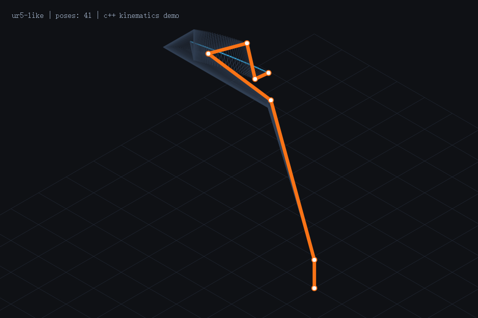

# ArmForge

六轴机械臂运动学、轨迹规划与伺服仿真（C++20，零第三方依赖）

[](https://github.com/haha666-123/ArmForge/actions/workflows/ci.yml)


> 面向具身智能 / 机器人软件岗位的工程项目：从 DH 参数、正逆运动学、轨迹规划、碰撞检测，
> 到伺服跟踪仿真和"自然语言 → 动作序列"的任务规划，全部可编译、可测试、可复现。



## 为什么做这个项目

工业上位机（Qt + Modbus）解决的是"设备怎么连、数据怎么采"，
机器人软件还要多回答三个问题：

1. **末端要到哪里**——逆运动学（IK）：给定位姿求关节角，还要处理关节限位、奇异点、多解；
2. **怎么过去**——轨迹规划：关节空间同步、速度/加速度约束、笛卡尔直线插补；
3. **过去安不安全**——碰撞检测与伺服跟踪误差。

ArmForge 把这三件事做成一个可测试的 C++ 库，并额外给了一个**受约束的 LLM 任务规划层**：
自然语言先转成 5 条指令的 DSL，再逐条做可达性、限位、碰撞校验，校验不过就不下发。

## 功能

| 模块 | 内容 |
| --- | --- |
| `model/ArmModel` | 标准 DH 参数表、关节限位、UR5 几何、碰撞胶囊半径 |
| `kin/Kinematics` | 正运动学、几何雅可比、阻尼最小二乘 IK（DLS）、位置优先 IK、多起点求解 |
| `traj/Trajectory` | 关节空间同步梯形速度 / 五次多项式插值、笛卡尔直线插补（逐点 IK + 分支连续性检查） |
| `collision/Collision` | 线段—线段最近距离、连杆胶囊自碰撞、地面平面检查 |
| `control/ServoSim` | 200 Hz 离散伺服环仿真：P 控制 + 速度/加速度限幅 + 关节限位，输出跟踪误差 |
| `ai/ActionPlanner` | 规则规划器 + LLM 规划器（注入式 transport）、5 条指令的 DSL 解析、动作序列校验 |
| `viz/SvgRenderer` | 等轴测投影，把位姿序列和末端轨迹渲染成 SVG（README 图片由它生成） |
| `app/main.cpp` | 命令行：`demo` / `fk` / `ik` / `plan` |

## 架构

```
                 ┌────────────────┐
 自然语言 ──────▶ │ ActionPlanner  │ ── DSL ──▶ 校验（限位/可达/碰撞）
                 └────────────────┘                    │
                                                       ▼
   ┌──────────┐    ┌──────────────┐    ┌──────────────┐    ┌───────────────┐
   │ ArmModel │───▶│ Kinematics   │───▶│ Trajectory   │───▶│ ServoSim      │
   │ DH/限位  │    │ FK/Jacobian  │    │ 梯形/五次/直线│    │ 200Hz 跟踪误差 │
   └──────────┘    │ DLS IK       │    └──────────────┘    └───────────────┘
                   └──────────────┘             │
                          │                     ▼
                          ▼              ┌──────────────┐
                   ┌──────────────┐      │ SvgRenderer  │──▶ out/arm.svg
                   │ Collision    │      └──────────────┘
                   └──────────────┘
```

## 核心实现

### 1. 正运动学与雅可比

标准 DH 变换：

```
A_i = RotZ(θ_i) · TransZ(d_i) · TransX(a_i) · RotX(α_i)
T   = A_1 · A_2 · … · A_6
```

雅可比按几何法逐列构造：关节 `i` 的旋转轴 `z_{i-1}` 与原点 `p_{i-1}`，

```
J_v,i = z_{i-1} × (p_e - p_{i-1})      J_w,i = z_{i-1}
```

测试里用**中心差分**逐列验证雅可比：`(FK(q+εe_i) - FK(q)) / ε` 与 `J` 的前三行一致（误差 < 1e-4）。

### 2. 逆运动学：DLS + 多起点

迭代式阻尼最小二乘：

```
e  = [p_target - p(q);  rotvec(R_target · R(q)^T)]
Δq = J^T (J J^T + λ² I)^{-1} e
q  ← clamp(q + clamp_norm(Δq, max_step))
```

- 关节限位在每步之后钳制，超出就停在上限并继续迭代；
- `position_only` 模式只约束末端位置（抓取放置常用），把 6×N 雅可比裁成 3×N；
- DLS 会掉进局部极小：基准测试里单起点收敛率 **73%**，`solve_ik_best` 追加 3 个基座旋转种子后升到 **86%**，
  代价是单次求解从 0.15 ms 涨到 0.39 ms。这个取舍写进了 README 而不是藏起来。

### 3. 轨迹规划

- **关节空间同步**：每个关节按自身 `vmax/amax` 生成梯形（或五次）速度曲线，取最长者为总时长，
  其余关节按比例拉伸时间，保证同时到达；
- **笛卡尔直线**：按 5 mm 步长采样直线，逐点 IK，用上一点解作为种子保证分支连续，
  相邻关节跳变超过 0.35 rad 判定接近奇异并报错；
- 姿态插值走 `R(s) = R0 · exp(s · log(R0^T R1))`。

### 4. 碰撞与伺服

- 每个连杆近似为胶囊（线段 + 半径），自碰撞只检查相隔 ≥2 的连杆对，外加地面平面；
  基座连杆固定在地面，不参与地面检查（否则零位必然误报）；
- 伺服环按 200 Hz 离散：比例项 → 速度限幅 → 加速度限幅 → 积分 → 关节限位，
  输出最大/均方根跟踪误差，用来判断"这条轨迹真机能不能跟得住"。

### 5. 任务规划：先约束，再执行

LLM（或规则）只能输出这 5 条指令：

```
move_joint <q1> ... <q6>
move_linear <x> <y> <z>
gripper open|close
wait <seconds>
home
```

解析器遇到未知指令**整段拒绝**；校验器逐条检查关节限位、目标可达性、碰撞，
任何一条不过就不下发。LLM 调用失败或输出不合语法时自动回退到规则规划器，并标记 `source=fallback`。

## 快速开始

```bash
cmake -S . -B build -DCMAKE_BUILD_TYPE=Release
cmake --build build -j
./build/bin/armforge_tests        # 39 个用例
./build/bin/armforge demo         # 全流程 + 生成 out/arm.svg
./build/bin/armforge_bench        # 微基准
```

Windows（MinGW）：

```powershell
cmake -S . -B build -G Ninja -DCMAKE_BUILD_TYPE=Release
cmake --build build
.\build\bin\armforge.exe demo
```

### Windows 免安装运行（单文件）

```bat
deploy.bat
```

脚本会构建、跑测试，然后把可执行文件打包到 `dist\`。默认开启
`ARMFORGE_STATIC_RUNTIME`，C++ 运行时静态链接，`armforge.exe` 只依赖系统自带的
`KERNEL32.dll` / `msvcrt.dll`，拷到任何 Windows 10+ 机器都能直接双击运行。

如果显式关掉静态链接（`-DARMFORGE_STATIC_RUNTIME=OFF`），脚本会用 `objdump` 读出 exe
真正 import 的非系统 DLL，并从 g++ 目录把 `libgcc_s_seh-1.dll`、`libstdc++-6.dll`
等一起拷进 `dist\`，保证两种情况都不会出现「缺少 XX.dll」。

`run.bat` 是快捷入口：优先跑 `dist\`，没有就退回 `build\`，并透传参数，例如
`run.bat fk --q "0 -1.2 1.2 0 0.9 0"`。

### demo 输出（实测）

```
ArmForge 1.0.0 | ur5-like | dof=6
home position: (-0.6107, -0.1603, 0.3906)

target taken from q = [0.35 -0.90 1.15 0.30 0.75 0.20]
target position: (-0.5456, -0.3794, 0.2150)

ik: converged in 4 iters, pos_err=3.2023e-05 rot_err=8.3816e-06
trajectory: duration=0.483 s, peak joint vel=1.446 rad/s, peak acc=6.000 rad/s^2
servo sim: 97 cycles, max err=3.388e-02 rad, rms err=1.459e-02, limits respected=yes
collision: clear, min clearance=0.0292 m
planner: 5 actions from "rule", validation=ok
wrote out/arm.svg and out/trajectory.csv
```

### 微基准（Windows 11 / i7 / MinGW 13.1 / Release）

| 操作 | 吞吐 | 单次耗时 |
| --- | --- | --- |
| 正运动学 + 雅可比 | 808k 次/s | 1.2 µs |
| IK（单起点，随机目标） | 6.6k 次/s，收敛 1459/2000（73%） | 0.15 ms |
| IK（多起点） | 2.5k 次/s，收敛 1716/2000（86%） | 0.39 ms |
| 轨迹采样 | 17.6M 次/s | 0.06 µs |

## 目录结构

```
ArmForge/
├── CMakeLists.txt
├── src/
│   ├── core/        Math.h（Vec3/Mat3/Mat4/线性方程组）、Status.h
│   ├── model/       ArmModel：DH 参数、限位、UR5 几何
│   ├── kin/         Kinematics：FK、雅可比、DLS IK、多起点
│   ├── traj/        Trajectory：梯形/五次插值、笛卡尔直线
│   ├── collision/   Collision：胶囊自碰撞、地面
│   ├── control/     ServoSim：200 Hz 跟踪仿真
│   ├── ai/          ActionPlanner：规则 + LLM + DSL 校验
│   ├── viz/         SvgRenderer：等轴测 SVG
│   └── app/         main.cpp：CLI
├── tests/           39 个用例，自带极简测试框架
├── bench/           微基准
└── docs/            README 用图
```

## 设计取舍

- **不用 Eigen**：6 自由度问题规模极小，手写 `Vec3/Mat3` 和 6×6 高斯消元足够，
  换来的是零依赖、CI 三平台十分钟内跑完；
- **不用 ROS/MoveIt**：这里要验证的是算法本身，ROS 封装放到下一步；
- **位置优先 IK**：抓取放置通常只关心末端位置，强制姿态会无解；
- **DSL 而不是自由 JSON**：解析面越小，LLM 出错的影响面越小，也更容易做静态校验；
- **UR5 参数**：公开数据表可查，便于复现和对照。

## 局限与下一步

- 没有动力学（力矩、惯量、摩擦），只有运动学 + 简单伺服模型；
- 没有真正的规划器（RRT*/OMPL），目前是关节空间 PTP + 笛卡尔直线；
- 没有真机/ROS2 接口：下一步做 `rclcpp` 节点，把 `JointTrajectory` 发到 `/joint_trajectory_controller`，
  并在 MuJoCo/Isaac Sim 里回放验证；
- 视觉闭环（相机标定、手眼标定、抓取位姿估计）未涉及。

## 许可证

MIT
